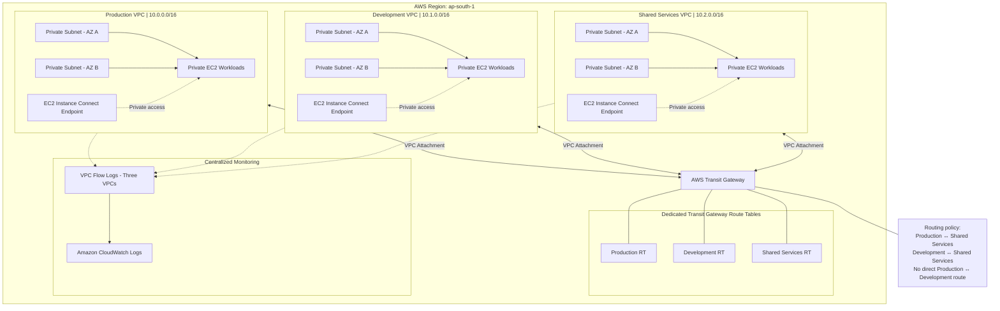

# AWS Multi-VPC Hub-and-Spoke Network Architecture

A Terraform-based AWS networking project implementing a multi-VPC
hub-and-spoke architecture using AWS Transit Gateway, centralized Shared
Services connectivity, controlled network segmentation, private EC2
access, and VPC Flow Logs.

## 1. Project Overview

This project uses Terraform to define an AWS multi-VPC network
architecture consisting of three VPCs connected through a central AWS
Transit Gateway.

The architecture follows a hub-and-spoke model in which Production and
Development VPCs communicate with a central Shared Services VPC, while
direct Production-to-Development communication is restricted through
explicit routing controls.

The infrastructure is defined using reusable Terraform configurations
and organized into environment-specific resources and a separate network
module.

## 2. Architecture

### Network Topology



### VPC Design
| VPC | CIDR Block | Purpose |
|---|---|---|
| Production | `10.0.0.0/16` | Production workloads |
| Development | `10.1.0.0/16` | Development workloads |
| Shared Services | `10.2.0.0/16` | Shared network services |

Each VPC is designed with two private subnets distributed across two
Availability Zones.

-   Total VPCs: 3
-   Total private subnets: 6
-   Availability Zones: 2
-   Public subnets: None
-   Internet Gateway: Not configured
-   NAT Gateway: Not configured

The Terraform configuration defines EC2 instances without public IP
addresses.

## 3. Transit-Gateway Architecture

AWS Transit Gateway acts as the central routing hub connecting the three
VPCs.

### Transit-Gateway Components

-   One AWS Transit Gateway.
-   Three VPC attachments.
-   Three dedicated Transit Gateway route tables.
-   Explicit route table associations.
-   Static routes for controlled inter-VPC connectivity.
-   Default route table association and propagation disabled.

### Routing Strategy
| TGW Route Table | Destination | Target |
|---|---|---|
| Production | `10.2.0.0/16` | Shared Services attachment |
| Development | `10.2.0.0/16` | Shared Services attachment |
| Shared Services | `10.0.0.0/16` | Production attachment |
| Shared Services | `10.1.0.0/16` | Development attachment |

### Network Segmentation

The routing design defines the following connectivity model:

-   Production → Shared Services: Allowed by routing design.
-   Development → Shared Services: Allowed by routing design.
-   Shared Services → Production: Allowed by routing design.
-   Shared Services → Development: Allowed by routing design.
-   Production ↔ Development: No direct routes configured.

Separate Transit Gateway route tables and explicit route management
implement the intended routing segmentation.

Actual traffic permissions also depend on VPC route tables, security
groups, network ACLs, and destination services.

## 4. Private EC2 Access

The Terraform configuration defines EC2 instances in private subnets
without public IP addresses.

AWS EC2 Instance Connect Endpoints (EICE) are defined to provide private
connectivity to the instances.

### Implementation

-   Three EC2 Instance Connect Endpoints.
-   One endpoint per VPC.
-   Dedicated security groups for endpoint access.
-   SSH ingress restricted to the corresponding endpoint security group.
-   No public SSH ingress rules.

This design avoids exposing EC2 instances directly to the public
internet.

## 5. Security Design

Security controls are defined using AWS security groups and network
segmentation.

Key controls include:

-   Separate security groups for EC2 instances in each VPC.
-   Dedicated security groups for EC2 Instance Connect Endpoints.
-   SSH access restricted through security-group references.
-   ICMP rules configured for intended internal connectivity testing.
-   Default security group rules emptied by the network module.
-   No public IP assignment to EC2 instances.
-   No direct Production-to-Development routing.

Security groups are stateful. Their rules control which traffic is
permitted at the instance level.

## 6. Network Monitoring

The Terraform configuration defines VPC Flow Logs for all three VPCs.

### Monitoring Components

-   VPC Flow Logs for each VPC.
-   Central CloudWatch log group.
-   CloudWatch integration for network traffic visibility.

Flow Logs provide visibility into network traffic and can help
investigate connectivity issues, identify rejected traffic, and
understand network communication patterns.

## 7. AWS Services Used
| AWS Service | Purpose |
|---|---|
| Amazon VPC | Network isolation |
| Private Subnets | Host private workloads |
| AWS Transit Gateway | Central network connectivity |
| Amazon EC2 | Compute workloads |
| EC2 Instance Connect Endpoint | Private instance access |
| Security Groups | Instance-level traffic control |
| VPC Flow Logs | Network traffic monitoring |
| Amazon CloudWatch Logs | Flow Log storage and visibility |
| AWS IAM | Deployment identity and permissions |

## 8. Technology Stack

-   Amazon Web Services (AWS)
-   Terraform
-   HashiCorp Configuration Language (HCL)
-   Linux / Ubuntu
-   Git
-   GitHub
-   TFLint

## 9. Repository Structure

``` text
aws-hub-spoke-terraform/
├── docs/
│   └── screenshots/
│       ├── 01-VPC-Network/
│       ├── 02-Transit-Gateway/
│       ├── 03-EC2-and-Security-Groups/
│       └── 04-CloudWatch-Flow-Logs/
├── environments/
│   └── dev/
│       ├── main.tf
│       ├── providers.tf
│       ├── attachments.tf
│       ├── ec2-instances.tf
│       ├── eice-endpoints.tf
│       ├── eice-security-groups.tf
│       ├── security-groups.tf
│       ├── ssh-ingress-rules.tf
│       ├── transit-gateway.tf
│       ├── tgw-associations.tf
│       ├── tgw-route-tables.tf
│       ├── tgw-routes.tf
│       ├── vpc-flow-logs.tf
│       ├── vpc-route-associations.tf
│       ├── vpc-route-tables.tf
│       ├── vpc-tgw-routes.tf
│       └── .terraform.lock.hcl
├── modules/
│   └── network/
│       ├── main.tf
│       ├── outputs.tf
│       └── versions.tf
├── .gitignore
├── .tflint.hcl
├── LICENSE
└── README.md
```

## 10. Deployment Instructions

### Prerequisites

-   An AWS account.
-   AWS CLI configured with appropriate credentials.
-   Terraform CLI version 1.5.0 or later.
-   Appropriate IAM permissions to provision the required AWS resources.

Run the following commands from the repository root unless a different
directory is specified.

### Initialize Terraform

``` bash
cd environments/dev
terraform init
```

### Format Configuration

From the repository root, check formatting across the root module and
child module directories:

``` bash
cd ../..
terraform fmt -check -recursive
```

To apply formatting instead of checking it, use
`terraform fmt -recursive`.

### Validate Configuration

``` bash
cd environments/dev
terraform validate
```

### Run TFLint

Run TFLint from the environment directory:

``` bash
tflint --init
tflint
```

### Review Infrastructure Plan

``` bash
terraform plan
```

### Deploy Infrastructure

After reviewing the plan, confirming permissions, and checking the
expected AWS costs:

``` bash
terraform apply
```

Review all resource changes before approving the deployment.

### Destroy Infrastructure

After completing testing, remove the Terraform-managed resources:

``` bash
terraform destroy
```

Review all proposed resource changes before approving destruction.

## 11. Network Validation

The deployed infrastructure was validated through connectivity tests,
Transit Gateway route inspection, and CloudWatch Flow Logs.

### Validation Results
| Test | Expected Result | Actual Result |
|---|---|---|
| Production ↔ Shared Services | Connectivity allowed | Successful |
| Development ↔ Shared Services | Connectivity allowed | Successful |
| Production ↔ Development | Direct connectivity restricted | Blocked |
| VPC Flow Logs | Traffic records visible | Verified in CloudWatch |
| Private EC2 access | Access through EC2 Instance Connect Endpoints | Tested |
| Transit Gateway routing | Explicit routes and associations | Verified |

The Production and Development VPCs communicated with the Shared
Services VPC, while direct Production-to-Development communication was
restricted by the Transit Gateway routing design.

Connectivity testing confirmed the intended network segmentation.

## 12. Project Evidence

The following screenshots document the AWS infrastructure deployed and
tested during this project.

### 12.1 VPC Network

-   [VPC Overview](docs/screenshots/01-VPC-Network/VPCs.png)
-   [Subnet Configuration](docs/screenshots/01-VPC-Network/Subnets.png)

### 12.2 Transit Gateway Architecture

-   [Transit Gateway
    Overview](docs/screenshots/02-Transit-Gateway/Transit-Gateway.png)
-   [Transit Gateway
    Attachments](docs/screenshots/02-Transit-Gateway/TGW-Attachments.png)
-   [Production Route
    Table](docs/screenshots/02-Transit-Gateway/TGW-Production-Route-Table.png)
-   [Development Route
    Table](docs/screenshots/02-Transit-Gateway/TGW-Development-Route-Table.png)
-   [Shared Services Route
    Table](docs/screenshots/02-Transit-Gateway/TGW-Shared-Services-Route-Table.png)
-   [Production Route Table
    Association](docs/screenshots/02-Transit-Gateway/TGW-Production-Route-Table-Association.png)
-   [Development Route Table
    Association](docs/screenshots/02-Transit-Gateway/TGW-Development-Route-Table-Association.png)
-   [Shared Services Route Table
    Association](docs/screenshots/02-Transit-Gateway/TGW-Shared-Services-Route-Table-Association.png)
-   [Production Route
    Entries](docs/screenshots/02-Transit-Gateway/Production-Route-Table-Routes.png)
-   [Development Route
    Entries](docs/screenshots/02-Transit-Gateway/Development-Route-Table-Routes.png)
-   [Shared Services Route
    Entries](docs/screenshots/02-Transit-Gateway/Shared-Services-Route-Table-Routes.png)

### 12.3 EC2 and Security Groups

-   [EC2
    Instances](docs/screenshots/03-EC2-and-Security-Groups/EC2-Instances.png)
-   [EC2 Instance Connect
    Endpoints](docs/screenshots/03-EC2-and-Security-Groups/EC2-Instance-Connect-Endpoints.png)
-   [Security
    Groups](docs/screenshots/03-EC2-and-Security-Groups/Security-Groups.png)
-   [VPC Route Tables
    Overview](docs/screenshots/03-EC2-and-Security-Groups/VPC-Route-Tables.png)

### 12.4 CloudWatch VPC Flow Logs

The following screenshots show sample network traffic records captured
by VPC Flow Logs in CloudWatch. They are examples of captured records,
not proof that every connectivity-test packet was logged.

-   [Flow Logs Record
    01](docs/screenshots/04-CloudWatch-Flow-Logs/CloudWatch-Flow-Logs-01.png)
-   [Flow Logs Record
    02](docs/screenshots/04-CloudWatch-Flow-Logs/CloudWatch-Flow-Logs-02.png)
-   [Flow Logs Record
    03](docs/screenshots/04-CloudWatch-Flow-Logs/CloudWatch-Flow-Logs-03.png)
-   [Flow Logs Record
    04](docs/screenshots/04-CloudWatch-Flow-Logs/CloudWatch-Flow-Logs-04.png)
-   [Flow Logs Record
    05](docs/screenshots/04-CloudWatch-Flow-Logs/CloudWatch-Flow-Logs-05.png)
-   [Flow Logs Record
    06](docs/screenshots/04-CloudWatch-Flow-Logs/CloudWatch-Flow-Logs-06.png)
-   [Flow Logs Record
    07](docs/screenshots/04-CloudWatch-Flow-Logs/CloudWatch-Flow-Logs-07.png)
-   [Flow Logs Record
    08](docs/screenshots/04-CloudWatch-Flow-Logs/CloudWatch-Flow-Logs-08.png)

## 13. Cost Considerations

AWS networking resources can generate charges even when workloads are
idle.

Resources requiring particular cost attention include:

-   Transit Gateway and attachment processing.
-   EC2 Instance Connect Endpoints.
-   EC2 instances.
-   VPC Flow Logs and CloudWatch log ingestion and storage.

Review AWS pricing for the selected region before deployment and remove
unused resources when they are no longer required.

## 14. Infrastructure Cleanup

After completing deployment and validation, the infrastructure was
destroyed using Terraform.

-   Terraform destroy completed successfully.
-   77 resources destroyed.
-   Terraform state list returned no remaining managed resources.

This removed the 77 Terraform-managed resources after testing. AWS
billing and the account's resource inventory should be checked
separately for any residual resources or charges.

## 15. Future Enhancements

Potential improvements include:

-   Terraform modules for additional infrastructure components.
-   Remote Terraform state management using Amazon S3.
-   Automated infrastructure deployment using GitHub Actions.
-   GitHub Actions authentication using AWS IAM OIDC.
-   Automated infrastructure cost monitoring and FinOps controls.
-   Expanded observability and security monitoring.

## 16. License

This project is licensed under the MIT License. See the [LICENSE](LICENSE) file for details.


## 17. Author

**Bara Bawdri Saivammsi**

Aspiring Cloud Engineer \| AWS \| Terraform \| Linux

**Project:** AWS Multi-VPC Hub-and-Spoke Network Architecture

**Cloud Platform:** Amazon Web Services

**Infrastructure as Code:** Terraform

**GitHub:** [SaivammsiBara](https://github.com/SaivammsiBara)
